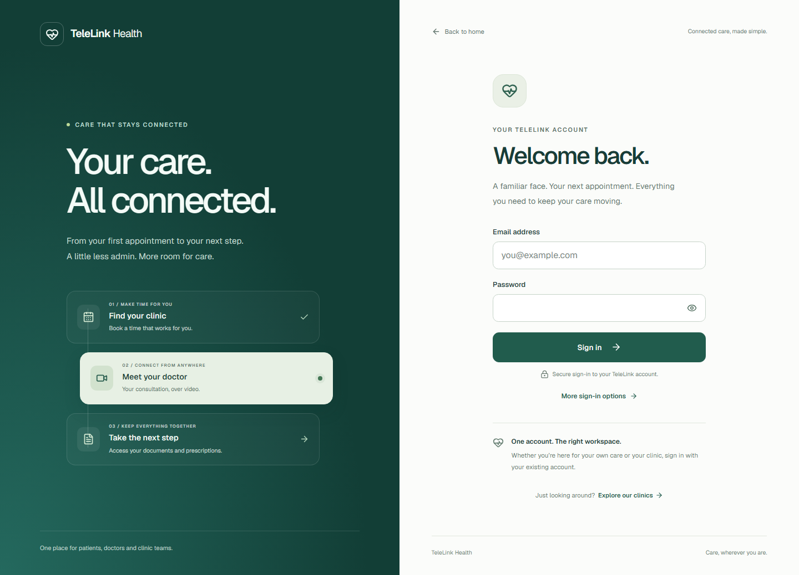
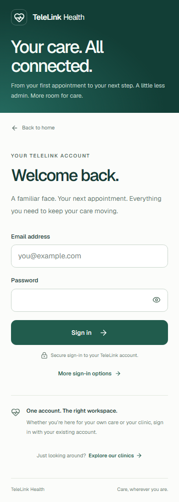

# RF03: custom login form

Open `/sign-in`, or choose **Sign in** from the signed-out application header.
The branded email/password form includes a password visibility toggle,
password-manager autocomplete, keyboard focus/skip navigation, pending feedback
and safe retry messages. Passwords are cleared after each submitted attempt and
are never persisted or logged by the application. Tokens use the existing
session storage, refresh and logout implementation.

**Sign in** calls Cognito `InitiateAuth` with `USER_PASSWORD_AUTH` on the configured
public client. **More sign-in options** retains the hosted authorization-code +
PKCE flow. Accounts requiring MFA, password changes or another challenge are not
given a session by the password form; they can continue through hosted sign-in.
Signup and password recovery are outside this task.

## Components

- `SignInPage` composes the page layout and signed-in/notice states.
- `PasswordSignInForm` owns the email, password and visibility state and form controls.
- `SignInStory` contains the static branding and decorative journey panel.
- `AuthControls` coordinates authentication, session refresh and logout.

The login components, session module, stylesheet and session tests are formatted
with Prettier using single quotes and no semicolons.

## Authentication policy

Cognito password-login tokens carry `aws.cognito.signin.user.admin` instead of the
OAuth `openid` scope. The new service setting
`SERVICE_AUTH_ALLOW_PASSWORD_TOKENS=true` explicitly permits that reserved scope
as an alternative to the `openid` authentication scope. It defaults to false.
All other configured custom API scopes remain required, and the verifier still
checks RS256 signatures, issuer, client, token use and expiry. The original
scope claim is returned unchanged. A Cognito self-service scope never grants a
TeleLink platform or clinic administrative role: database-backed role and tenant
checks still control access.

This policy change was explicitly approved by the requesting user. The local
bootstrap/configuration generators enable it; existing deployments must opt in
and restart/rebuild services. See [AWS authentication models](https://docs.aws.amazon.com/cognito/latest/developerguide/authentication-flows-public-server-side.html).

## Setup

No new package dependencies or migrations.

- The public Cognito app client must allow `ALLOW_USER_PASSWORD_AUTH` alongside
  `ALLOW_REFRESH_TOKEN_AUTH`. `dev/floci/cognito.sh` and `dev/clinic_local.py` now
  configure both. Retain the existing OAuth code flow for hosted sign-in.
- Set `SERVICE_AUTH_ALLOW_PASSWORD_TOKENS=true` for APIs requiring `openid`.
  Updated local environment examples and `dev/compose/setup.py` include it.
  Existing host `.env` files are preserved by setup helpers, so add the setting
  explicitly and restart them using this checkout's shared Python package.
- Keep the existing frontend Cognito endpoint/client/issuer variables. Passwords
  go only to the configured authentication endpoint. AWS configuration requires
  HTTPS; plain HTTP remains restricted to local development endpoints.
- The browser origin must be allowed by Floci CORS. The port-5174 local preview
  uses `http://127.0.0.1:5174` and `http://localhost:5174` in root
  `COGNITO_CORS_ORIGINS`, followed by recreation of Floci.
- Hosted fallback/logout also needs the preview callback URLs
  `http://127.0.0.1:5174/auth/callback` and
  `http://localhost:5174/auth/callback`, with matching logout URLs at `/`.
  These have been added locally while preserving 8443/5173. Standard bootstrap
  replaces the callback allowlist; re-register extra preview origins after reset.

For AWS, explicitly enable the client flow and service policy and verify API
Gateway's accepted scopes support both authentication methods. AWS deployment,
real staff MFA/recovery and federated sign-in remain unverified; this PR does not
claim deployed compatibility.

## Verification

Verified locally on 23 October 2026:

- Frontend lint, TypeScript and production build; all 140 frontend tests pass.
- 27 backend token-policy tests pass, covering default rejection, explicit opt-in,
  required custom scopes, invalid signatures/algorithms, wrong issuer/client,
  ID tokens and expiry with the policy both disabled and enabled.
- Ruff checks pass for the changed Python modules; Cognito bootstrap shell syntax passes.
- Chromium layouts at 320, 390, 768 and 1440 pixels have no horizontal overflow.
- Real Floci password login, identity API role navigation and logout pass for
  patient, doctor, clinic administrator and platform administrator demo accounts.
- A real password-login refresh preserves access; the patient remains denied
  access to the platform administration workspace.
- Incorrect real credentials create no session and clear the password field.
- Keyboard skip navigation, password visibility and hosted fallback work; no
  browser page errors were observed.

Screenshots contain only decorative content, not patient records or live status.

## Desktop

## Mobile

