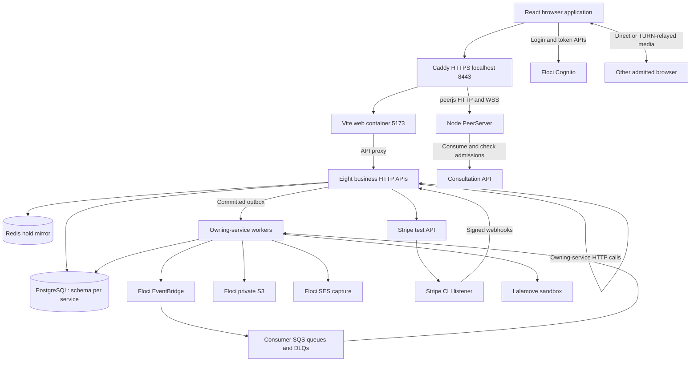
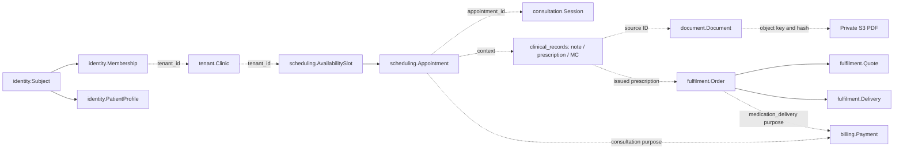
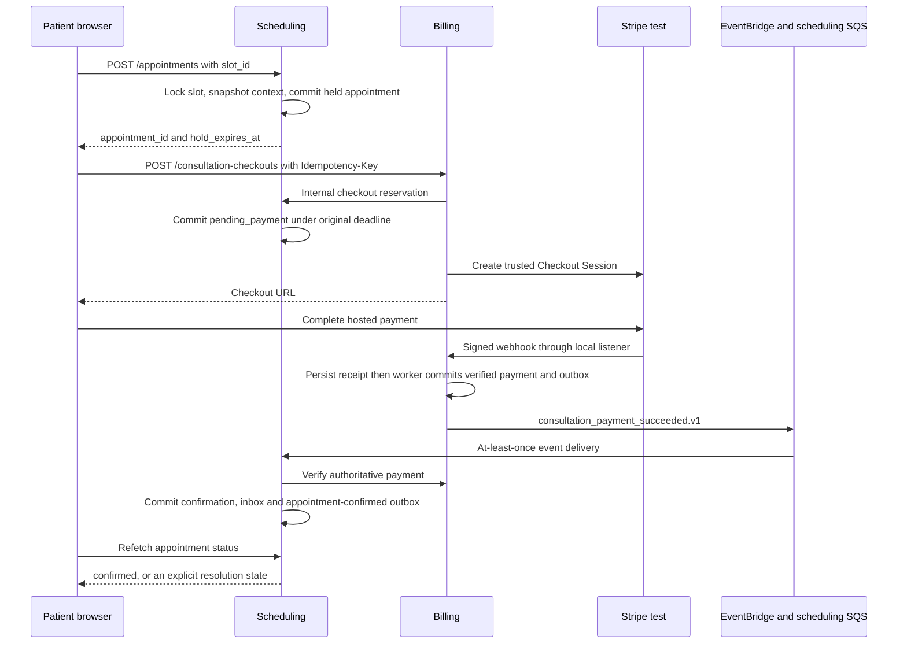
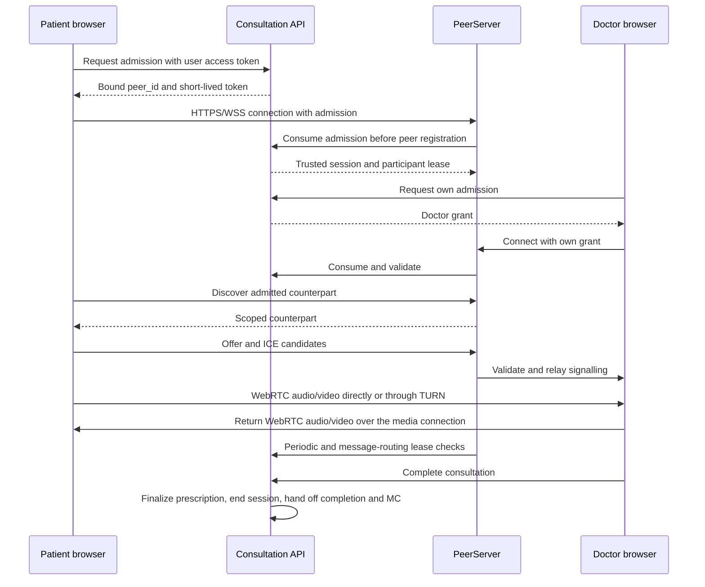
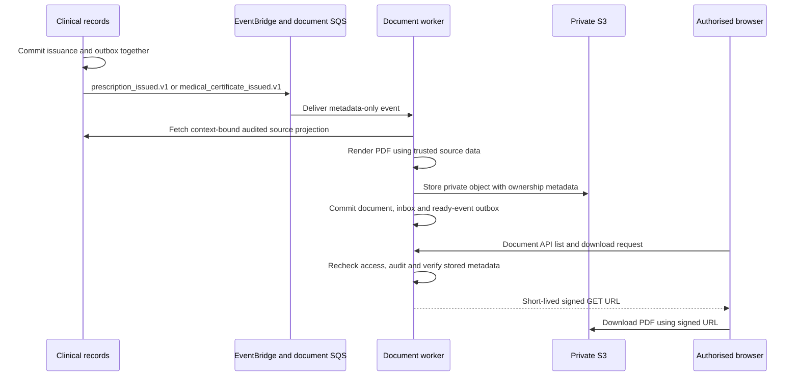
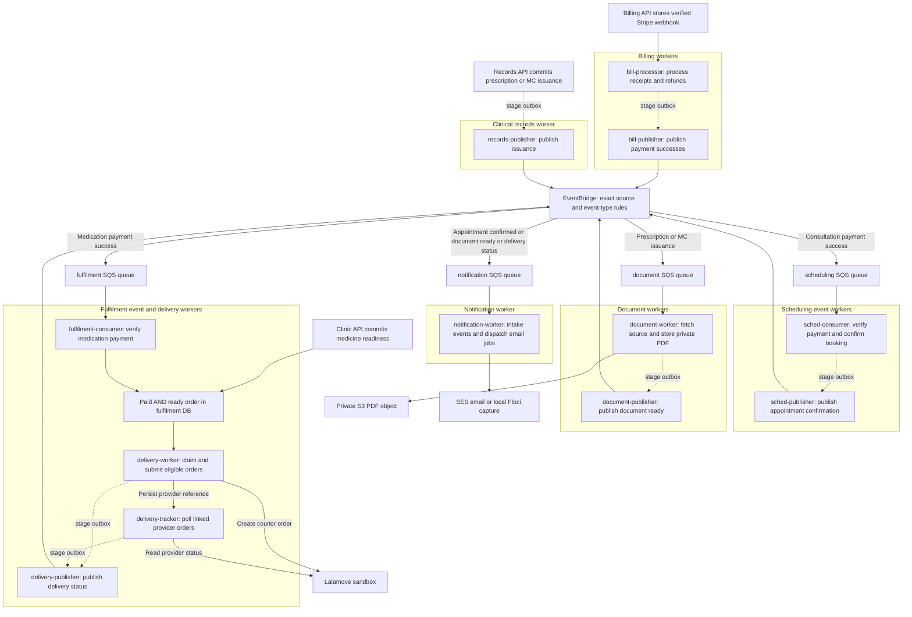
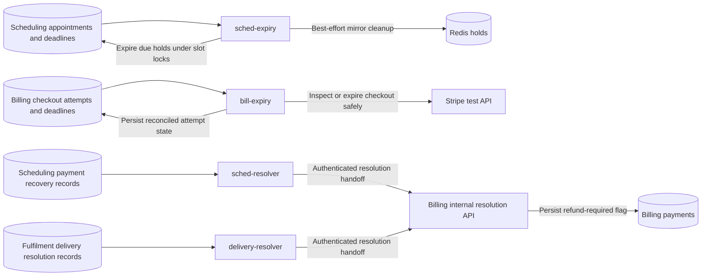

# TeleLink Health: technical architecture guide

This guide explains the system from its overall design down to requests,
transactions, workers and code entry points. It targets engineers working on the
CS5224 Team 39 prototype. Source review date: **27 October 2026**.

## Contents

1. [System overview and design choices](#1-system-overview-and-design-choices)
2. [Runtime architecture](#2-runtime-architecture)
3. [Service ownership and interfaces](#3-service-ownership-and-interfaces)
4. [Frontend implementation](#4-frontend-implementation)
5. [Backend implementation](#5-backend-implementation)
6. [Data model and security boundaries](#6-data-model-and-security-boundaries)
7. [End-to-end workflow traces](#7-end-to-end-workflow-traces)
8. [Events, consistency and failure recovery](#8-events-consistency-and-failure-recovery)
9. [Local operations and proposed AWS deployment](#9-local-operations-and-proposed-aws-deployment)
   - [Worker diagrams and explanations](#worker-diagrams-and-explanations)
10. [Code navigation, verification and troubleshooting](#10-code-navigation-verification-and-troubleshooting)

### How to read status claims

**Implemented** means source/configuration exists in this checkout. **Historical
verification** means another task recorded a result; this documentation task does
not reproduce that result. **Planned** means architecture intent without a deployed
implementation. Current source takes precedence over old task prose when explaining
behavior. The [backlog](../implementation-plan.md) tracks acceptance and remaining work;
[plan.md](../plan.md) records scope and architectural intent.

The full local application is implemented. AWS infrastructure and deployed AWS
verification remain unfinished. The generic FastAPI template is an optional
scaffolding example, not the only runnable backend. Statements to that effect in
older service documentation are stale. Likewise, planned React Router adoption
does not describe the current custom route parser.

## 1. System overview and design choices

TeleLink Health is a multi-tenant teleconsultation application. A **tenant** is a
clinic: its branding, staff, prices, appointments and medication operations have
an owning clinic ID (`tenant_id`). One frontend serves multiple clinics; clinics
do not receive separate application deployments.

The main journey is:

```text
Clinic registration and approval
  -> Doctor availability -> Patient slot hold -> Consultation payment
  -> Confirmed appointment -> Authorised video consultation
  -> Clinical notes, issued prescription and medical-certificate decision
  -> Private PDFs -> Medication order and delivery quote
  -> Separate medication/delivery payment + Clinic medicine readiness
  -> Courier submission -> Tracking and generic email notifications
```

| Role | Main capabilities | Important boundary |
| --- | --- | --- |
| Patient | Browse clinics, book/pay, join own consultation, read own records/PDFs, maintain profile, order medication | An appointment at a clinic does not expose unrelated patient history |
| Doctor | Manage availability, join assigned visits, record notes, prescribe and decide MC issuance | Requires current clinic membership and assigned appointment context |
| Clinic administrator | Manage clinic/staff/settings, appointments, medication preparation, payment views and eligible consultation refunds | Operational authority does not grant unrestricted clinical-record access |
| Platform administrator | Review/activate clinics, commission configuration and operational views | A platform role alone does not grant clinical-document or medicine-order access |

The architecture uses independently deployable services because booking capacity,
clinical information, money, PDFs and courier work have different owners and
failure modes. Each service owns its database schema, migrations and transaction
boundaries. Cross-service HTTP and events introduce extra coordination, but keep
one domain from directly modifying another domain's records.

The stack is React/TypeScript/Vite, TanStack Query, Tailwind/Radix UI components,
FastAPI/Pydantic/SQLAlchemy/Alembic, PostgreSQL, Redis, Node.js PeerServer and
browser WebRTC. Floci supplies local AWS-compatible APIs. Stripe test mode and
Lalamove sandbox are external integrations. Docker Compose runs the local system;
ECS Fargate is the intended business-service deployment target.

## 2. Runtime architecture



There are **nine Python business services**, but only **eight business HTTP
apps**: notification runs as a worker. The optional template is another HTTP app,
outside the nine business services. PeerServer is a separate Node.js workload.
Consultation is one of the eight APIs; it is drawn separately above to highlight
signalling admission.

The graph groups processes for readability; it does not imply every API can
access every schema, Redis, or provider. Scheduling uses Redis. Document workers
use private PDF storage; tenant also has a separate logo-storage integration.
Billing owns Stripe calls; fulfilment owns courier calls. Notification owns SES
sends. Worker containers reuse their owning service's image and configuration,
with a different command.

### Three different communication paths

| Path | Used for | Completion meaning |
| --- | --- | --- |
| Synchronous HTTP | Authorised reads, checkout reservations, lifecycle handoffs, provider calls | The called operation returned; this does not atomically commit the caller's database |
| Asynchronous events | Payment propagation, PDF generation, notifications, delivery updates | Producers commit facts; consumers process later and may receive duplicates |
| WebRTC media + PeerJS signalling | Audio/video and exchange of connection metadata | PeerServer routes signalling; media is direct or TURN-relayed, outside FastAPI |

### Local ingress and ports

The current full-stack path is **browser -> Caddy -> Vite proxy -> service**.
Caddy routes `/peerjs/*` directly to signalling and other requests to Vite.
The browser also needs its configured Cognito endpoint and browser-reachable
presigned S3 endpoint; Caddy is not a universal proxy for Floci.

| Workload | Default host endpoint | Container endpoint / detail |
| --- | --- | --- |
| HTTPS application | `https://localhost:8443` | Caddy -> `web:5173` or `signalling:9000` |
| Vite | `http://127.0.0.1:5173` | `web:5173` |
| Identity / tenant / scheduling | `127.0.0.1:8001` / `8002` / `8003` | Each Python API listens on container port 8000 |
| Consultation / clinical records | `127.0.0.1:8004` / `8005` | Container services `consultation` / `clinical_records` |
| Fulfilment / document / billing | `127.0.0.1:8006` / `8007` / `8009` | Port 8008 is not a notification API |
| PostgreSQL | `127.0.0.1:55432` by default | `postgres:5432`; persistent volume |
| Redis | `127.0.0.1:6379` | `redis:6379`; persistent volume |
| Floci | `localhost:4566` | `floci:4566`; persistent AWS-emulator resources |

Source: [Compose application overlay](../compose.app.yaml),
[Caddy routing](../dev/compose/Caddyfile), [Vite routing](../apps/web/vite.config.ts).

## 3. Service ownership and interfaces

Public browser prefixes are `/api/v1/<service>`. Most services receive paths with
that prefix stripped. **Clinical records and document retain their full prefix**
in current routers and Vite forwarding. `SERVICE_ROOT_PATH` describes proxy
context; it does not automatically add routes. Do not assume one universal rewrite
rule from older contract prose.

The table lists representative interfaces, not a complete OpenAPI specification.
HTTP paths are **service-local** unless explicitly prefixed. Internal paths
require their own credentials and context checks.

| Service / owned schema | Owned data and decisions | Representative interfaces and dependencies | Background work / emitted events |
| --- | --- | --- | --- |
| Identity / `identity` | Cognito subject mapping, global roles, memberships, patient profiles | `GET /me`, `POST /me/registration`, `GET/PUT /me/patient-profile`, clinic memberships, `POST /access-decisions`, internal purpose-specific subject projections; verifies clinic context through tenant where required | No dedicated Compose worker; no event producer in current workflow contracts |
| Tenant / `tenant` | Clinics, branding, activation/review, commission settings, pickup locations, administrative audits | `/clinics`, `/clinics/by-slug/{slug}`, clinic `/review`, `/commission`, `/location`; identity creator provisioning and staff lookups; internal booking/billing/document projections | No dedicated worker or current clinic-lifecycle event route; clinic coordination uses HTTP |
| Scheduling / `scheduling` | Fixed availability slots, holds, appointments, payment resolution/recovery | `/clinics/{tenant_id}/slots`, `/appointments`, appointment `/cancel`; internal checkout reservation, consultation start/complete, refund and notification context; tenant + billing reads | Hold expiry, payment consumption, outbox publication, resolution delivery; `appointment_confirmed.v1` |
| Consultation / `consultation` | Session lifecycle, trusted appointment snapshot, short-lived admissions and socket leases | `/admissions`, `/appointments/{appointment_id}/start` and `/complete`; internal admissions `/consume`, `/check`, `/release`; scheduling, billing, identity and records integrations | No dedicated Compose worker; explicit retryable lifecycle handoffs |
| Clinical records / `clinical_records` | Notes, prescription/item versions and corrections, MC decisions, user/service read audits | Full prefix `/api/v1/clinical-records`; appointment notes/prescriptions/MC, prescription `/issue`, `/finalize-prescription` under appointment; internal dispensing/PDF projections; scheduling, identity, tenant, fulfilment context | Outbox publisher; `prescription_issued.v1`, `medical_certificate_issued.v1` |
| Billing / `billing` | Payments, checkout attempts/keys, immutable charge/commission snapshots, webhook receipts, refund attempts | `/consultation-checkouts`, `/medication-checkouts`, `/payments`, payment `/refunds`, `/webhooks/stripe`; scheduling/tenant/fulfilment trusted sources and Stripe | Checkout expiry, webhook/payment processing, refund processing, outbox publication; the two payment-success events |
| Document / `document` | PDF metadata, object integrity/ownership bindings, download-access audit | Full prefix `/api/v1/document/documents`, document `/{document_id}/download`; internal notification context; records projections, scheduling access rechecks and S3 | Generation consumer, outbox publisher; `document_ready.v1` |
| Fulfilment / `fulfilment` | Catalogue/prices, prescription price snapshots, medication orders, quotes/contact snapshots, readiness, deliveries and exceptions | `/orders`, order `/quotes`, `/ready`, `/delivery-details`, `/deliveries/{delivery_id}`; internal checkout reservation; records, tenant, identity, billing and Lalamove | Payment consumer; submission, resolution, publication and tracking workers; `delivery_status_changed.v1` |
| Notification / `notification` | Durable email jobs, event inbox, recipient/send outcome | No business HTTP API in current Compose; fetches context from identity, scheduling, document and fulfilment using scoped service credentials | Event intake and SES dispatch in `app.worker`; no downstream workflow event |
| Signalling / no domain database | Live peer/socket bindings and transport restrictions | `/peerjs` HTTP/WSS and `/peerjs/counterpart`; consultation consumes/checks/releases admissions | Live connection/lease checks; no business event producer |

Read each service's `app/main.py`, `app/api/`, `app/models.py` and
`app/settings.py` for exact wiring. Notification uses `app/worker.py` instead of
an API entry point. [Backend structure](project-structure.md) describes the current
HTTP / operations / integration / worker separation.

## 4. Frontend implementation

### Startup, navigation and role checks

[main.tsx](../apps/web/src/main.tsx) mounts the React application and QueryClient.
[App.tsx](../apps/web/src/App.tsx) reads `window.location.pathname`, passes it to
[parseRoute](../apps/web/src/navigation/access.ts), and composes `AppShell` with
`AppRoutes`. This is a custom route union/parser and component switch; React Router
is not installed. Links and browser navigation select paths; query parameters
carry workflow context where a feature needs it.

`AppShell` loads the server's current identity and memberships. It redirects
protected unauthenticated pages to sign-in and applies role/clinic guards before
showing content. Identity polling runs every 30 seconds with focus refetch enabled.
These guards shape the UI; each backend operation independently authorises access.

| Representative URL | Feature |
| --- | --- |
| `/clinics/:slug` | Public storefront |
| `/patient/clinics/:slug/book` | Slot selection and booking |
| `/patient`, `/doctor` | Upcoming/Past appointment workspaces |
| `/patient/consultation`, `/doctor/consultation` | Booked room and clinical workflow |
| `/patient/profile`, `/patient/prescriptions`, `/patient/documents` | Profile, records and PDF access |
| `/patient/medication-orders` | Medication checkout and tracking |
| `/clinic-admin/clinics/:tenantId/{profile,staff,payments,orders,appointments,settings}` | Clinic-scoped operations; braces describe alternatives, not a literal URL |
| `/platform-admin/clinics` | Clinic review and platform operations |

### Features, transport and cached state

Feature code lives under `src/features`. Large domains separate API transport,
types, hooks, pages and workflow components; navigation imports public feature
entry points. Authentication belongs under `src/auth`, and generic UI/transport
utilities under `src/components` and `src/lib`.

[apiFetch](../apps/web/src/lib/api.ts) resolves the configured API base, adds a
bearer token when supplied, omits cookies, disables caching and rejects redirects.
Feature adapters encode endpoint-specific payloads, validate responses and handle
domain errors. Types include both generated contract artifacts and feature-owned
wire/domain types; do not assume every TypeScript interface is generated.

[QueryClient defaults](../apps/web/src/lib/query-client.ts) disable automatic
query/mutation retries and focus refetch. Features explicitly opt into polling,
invalidation and other behavior. Keys include user/session or clinic/resource
context where required. Clinical draft autosave and video lifecycle hooks have
their own timing; a cached component is not authority to submit a state change.

### Authentication and session lifecycle

The branded form uses Cognito password authentication; hosted authorization-code
login with PKCE is also supported. Signup includes confirmation/resend and
authenticated idempotent patient provisioning from verified Cognito attributes.
Existing users are not silently granted extra memberships.

[session.ts](../apps/web/src/auth/session.ts) stores the shared same-origin session
in `localStorage`; PKCE transactions remain tab-local in `sessionStorage`. Storage
events synchronize account changes and logout. A per-storage promise coalesces
refreshes within a tab, and Web Locks serialize cross-tab refresh where supported.
A late refresh checks the current session before writing, so it cannot undo logout
or overwrite a changed account. Stored browser tokens remain sensitive to script
execution in that origin; this is the actual implementation, not an HTTP-only
cookie session. See [authentication](authentication.md) for configuration and
known Floci/AWS differences.

## 5. Backend implementation

### A request from ingress to commit

```text
Browser feature adapter
  -> /api/v1/<service>/resource
  -> Vite proxy (service-specific rewrite)
  -> FastAPI middleware and request ID
  -> Token verification + current identity / membership dependencies
  -> Pydantic request validation and domain authorisation
  -> Router -> business operation -> owning DB / authorised upstream adapter
  -> Transaction: rows + relevant audit/inbox/outbox records
  -> Explicit commit -> response model -> JSON
```

Routers handle HTTP inputs, dependencies and response mapping. `services/` holds
reusable business operations; `integrations/` holds owning-service HTTP and provider
clients. `workers/` orchestrates background work. Some small operations remain in
routers; these are responsibility boundaries, not a requirement to add layers to
every function.

`main.py` builds the application and lifecycle resources: settings, database
engine, upstream clients, routers, middleware and health probes. `__main__.py`
provides the runnable API entry point. `database.py` supplies sessions;
`models.py` defines persistence and constraints; `schemas.py` defines wire models.
Alembic migrations live inside the service, and setup applies them explicitly.

### Shared technical utilities

[python_common](../packages/python_common/README.md) provides JWT verification,
access primitives, short-lived service credentials, settings/AWS clients, structured
logging, middleware/error envelopes, cursor mechanics, typed event envelopes and
outbox/inbox operations. Service-owned models and workflow policies stay local.
For example, the shared library validates an event's schema; scheduling still
decides whether that payment can confirm that appointment.

### Concrete booking code trace

Follow [scheduling booking](../services/scheduling/app/api/booking.py) into
[hold operations](../services/scheduling/app/services/holds.py) and the
[database model](../services/scheduling/app/models.py):

1. Authenticate the patient and obtain trusted clinic/doctor/price context.
2. Lock the slot, expire old reservations under the same transaction and create
   the appointment with an immutable schedule/price snapshot.
3. Enforce one active reservation with PostgreSQL constraints. Active reservation
   states are `held`, `pending_payment`, `confirmed` and `in_progress`.
4. Set the deadline to the earlier of server time + 10 minutes and slot start.
   PostgreSQL `clock_timestamp()` avoids using a stale transaction-start time
   after waiting for a lock. Equality with the deadline is expired.
5. Mirror the hold in Redis with the persisted deadline. Redis errors do not make
   Redis the capacity authority or invalidate an otherwise durable reservation.

Expiry, checkout, cancellation and payment processing share slot-before-appointment
lock order. The slot's database constraints remain the final capacity protection.

## 6. Data model and security boundaries

### Logical relationships and snapshots

These are **logical cross-service references**, not permission to join or mutate
another service's tables. Local SQL foreign keys protect relationships within
an owning schema; external IDs are checked through the owning APIs.



| Domain | Important records and invariants |
| --- | --- |
| Identity | `subjects` maps opaque Cognito `sub` to application UUID; global roles are patient/platform admin. `memberships` holds clinic doctor/admin roles and active/revoked status. Patient profile belongs to its subject |
| Tenant | `clinics` has unique slug, status, consultation price and commission basis points; `clinic_locations` owns saved pickup settings; `audit_events` records administrative changes |
| Scheduling | Slots are 30 minutes; a PostgreSQL exclusion constraint prevents overlapping non-withdrawn doctor slots. Appointments bind slot/tenant/doctor/time context and store payment-resolution state; recovery records preserve late/duplicate-payment decisions |
| Consultation | One session per appointment with immutable participant/schedule context; admission rows bind short-lived credentials and leases to that session/peer |
| Records | Notes, prescriptions/items, correction records and MC decisions carry appointment/tenant/patient/doctor context. Drafts may be edited under policy; issued records use controlled correction flows |
| Billing | Payments distinguish `consultation` from `medication_delivery`; only the corresponding appointment or order/quote links apply. Checkout attempts/keys, webhook events and refund attempts make retries durable |
| Fulfilment | One order per prescription; order items and prices are snapshots. Quote rows preserve route/recipient/fee/expiry context. Payment, medicine readiness and delivery are separate state dimensions |
| Document | Metadata links source and appointment/participants to object key, size and SHA-256; access audits record authorised list/download operations |
| Notification | Inbox plus durable `jobs` records separates event intake from email sending and stores send outcomes |

Snapshots explain why a later profile, clinic price or catalogue edit does not
rewrite an accepted charge or delivery route. Identity owns current patient
contact/address defaults; fulfilment owns the confirmed order/quote contact
snapshot. Checkout can optionally save edits back to Profile, but those are distinct
writes. Monetary values use integer minor units and currency, for example
`{"amount_minor":2500,"currency":"SGD"}`. Commission is stored in basis points,
where 10,000 means 100%; billing freezes the applied split at payment creation.

### Authentication is separate from authorisation

**User access tokens:** APIs verify signature/JWKS, issuer, expiration, token use,
client and required scopes. ID tokens are not API credentials. Cognito authenticates
the person; identity's server-owned records decide application roles and clinic
memberships. Cognito groups alone grant no TeleLink access.

The password-login reserved scope is accepted only through explicit
`SERVICE_AUTH_ALLOW_PASSWORD_TOKENS` configuration. It never grants an application
administrator role. A selected clinic or supplied `tenant_id` is input to validate,
not proof of authority.

**Service credentials:** purpose-specific short-lived JWTs authenticate internal
callers separately from users. [Shared service authentication](../packages/python_common/telelink_common/service_auth.py)
uses HS256 with caller issuer/subject, audience and lifetime checks; some boundaries
have dedicated verifiers. The shared token generator issues 60-second tokens.
Services validate caller purpose and resource context after token verification.
Some operations instead forward the user's token to retain user-scoped policy,
such as authorised appointment reads and prescription finalization.

**Admission credentials:** video grants are a third credential class, bound to a
specific participant/session/peer and consumed by signalling. They are not a
replacement for the user's API token or arbitrary peer IDs.

### Privacy and tenant checks

Every domain lookup must check the appropriate combination of clinic, subject,
patient, doctor, appointment and source resource. Internal projections return only
the fields needed for dispensing, PDF generation, payment or notifications. Records
and document reads are audited. Many concealed-resource failures deliberately
return 404 rather than disclose another tenant's resource existence.

Current browser proxy rules block specified `/internal` routes; application service
authentication remains necessary when direct backend ports or different ingress
are used. Private networking alone does not authorise callers. PostgreSQL row-level
security is an architectural defense-in-depth proposal, not an implemented global
guarantee established by this guide.

PDFs live in private S3 storage. Download processing rechecks current appointment
access, audits it, verifies storage metadata against the document row and produces
a short-lived presigned GET URL. The signer must use the browser-reachable endpoint
when creating the signature; replacing the hostname afterward breaks SigV4.
Possession of an already-issued URL permits access until its expiry; later role
revocation blocks new authorised URL requests, not instant revocation of an old
URL. Deployed AWS privacy/revocation verification remains separate work.

## 7. End-to-end workflow traces

The HTTP examples below show **browser-facing paths**. UUID placeholders represent
existing authorised resources, not seed data or executable requests. Protected
calls use `Authorization: Bearer <access_token>`; JSON writes use Content-Type.
Creation flows requiring idempotency also use `Idempotency-Key`.

### 7.1 Clinic registration, approval and availability

1. An authenticated user posts `/api/v1/tenant/clinics`. Tenant reserves the slug
   and clinic row durably before calling identity's `/internal/clinic-creators`.
2. Identity creates the creator's clinic-admin membership idempotently. Tenant
   records provisioning completion. Retrying a lost response reuses the clinic;
   it cannot restore a subsequently revoked membership.
3. Platform administration reviews through
   `POST /api/v1/tenant/clinics/{tenant_id}/review`. Approval/commission/settings
   changes are audited. Clinic states include `pending_review`, `active`,
   `rejected` and `suspended`.
4. Authorised administration links staff through identity membership APIs. Doctor
   availability uses `POST /api/v1/scheduling/clinics/{tenant_id}/slots`.
5. Public storefront reads use the active-clinic directory/by-slug APIs. Booking
   rechecks active clinic and doctor context on the server.

There is no current clinic-lifecycle EventBridge route. Do not assume approval
works by publishing an event simply because the original plan proposed it.

### 7.2 Booking and consultation payment



The initial booking input is `POST /api/v1/scheduling/appointments` with
`{"tenant_id":"<tenant_uuid>","slot_id":"<slot_uuid>"}`. Consultation checkout is
`POST /api/v1/billing/consultation-checkouts` with
`{"appointment_id":"<appointment_uuid>"}` plus `Idempotency-Key`.
The backend reads trusted amounts and commission configuration; it does not charge
a browser-provided total. Checkout does not extend the hold.

The local Stripe CLI forwards events to billing's `/webhooks/stripe`. The receiver
checks a single signature header, verifies the raw bounded body and durably stores
the receipt. A worker processes it separately. A browser redirect back from
Stripe is navigation, not payment evidence. Payment success and appointment
confirmation are separate committed facts, so the UI refetches status.

If payment arrives after expiry, scheduling evaluates its guarded recovery policy:
the same slot must still be free, future, active and eligible. It never takes
capacity from a newer appointment or reopens a cancelled one. Otherwise the charge
remains successful and a durable refund-required exception is recorded/delivered
to billing. See [payment decisions](../services/scheduling/app/services/payments.py).

### 7.3 Video admission, signalling and consultation completion

The browser requests `POST /api/v1/consultation/admissions` with
`{"appointment_id":"<appointment_uuid>"}`. Consultation verifies current
appointment, participant/membership, payment and join-window context before issuing
a short-lived peer-bound grant. It is not enough to know the appointment UUID.



PeerServer validates origin, path/key and credential shape before registration,
and only routes permitted frames between distinct admitted participants in the
same session/tenant/appointment. General peer discovery and unauthenticated peer-ID
allocation are disabled. Lease checks deny stale/revoked eligibility; disconnect
cleanup releases the lease. A rejoin requests fresh admission.

PeerJS is the signalling client/server layer. **WebRTC carries media**. STUN helps
discover usable network candidates; TURN relays media when a direct connection
cannot be established. A successful HTTPS page or signalling connection alone
does not prove cross-network audio/video works. The application does not record
video. Real AWS cross-network/physical-device verification remains RF01.

Doctor start/complete uses consultation's appointment action routes. Completion
is a retryable sequence, not a distributed transaction:

1. Finalize any saved prescription through records with the doctor's credentials.
2. Persist the authorised local session end; completed local sessions deny new
   admissions even if an upstream handoff is temporarily unavailable.
3. Have scheduling accept the completed appointment transition.
4. Call records' internal MC completion endpoint to seal the saved decision and
   emit issuance if applicable. A missing MC choice does not imply an automatic MC.

[session_actions.py](../services/consultation/app/services/session_actions.py)
preserves these retry boundaries. The frontend completion handoff checks saved
records and offers completion retry when work remains.

### 7.4 Clinical notes, issuance and private PDFs

Notes use `PUT /api/v1/clinical-records/appointments/{appointment_id}/note`.
Prescriptions are created under an appointment, edited while draft and issued
with `POST /api/v1/clinical-records/prescriptions/{prescription_id}/issue`, or
finalized during consultation completion. MC decisions use the appointment's
`/medical-certificate` routes; completion seals the decision.



The document participant groups its API and worker for this diagram; they are
separate processes. Current issuance consumers generate prescription and MC PDFs.
Receipt generation appears in broader design/materials, but there is no payment
receipt event route in the current generation worker; sample receipt files are
not evidence of an integrated receipt pipeline.

Issuance commits state and its outbox in one records transaction. The document
worker fetches clinical content through a restricted projection rather than
putting it on the queue. Prescription generation uses deterministic document and
ready-event IDs, a source-scoped advisory lock and object metadata recovery. An
upload that survives a failed DB commit can be reused after ownership/integrity
verification rather than blindly generating a second logical document.

Lists use `GET /api/v1/document/documents`; download authorization uses
`GET /api/v1/document/documents/{document_id}/download`. The response contains
`download_url` and `expires_at`, not the file bytes.

### 7.5 Medication pricing, checkout, readiness and delivery

1. Fulfilment reads the issued prescription's authenticated dispensing projection.
   Catalogue pricing or prescription-specific pricing determines a server-owned
   snapshot; clinical content remains owned by records. Correction holds prevent
   unsafe checkout/dispensing while an authorised correction is coordinated.
2. The patient creates an order through `POST /api/v1/fulfilment/orders`. A quote
   is requested through `/orders/{order_id}/quotes`, with confirmed recipient,
   contact and destination inputs. Pickup settings come from the clinic's trusted
   configuration. The accepted quote snapshots the route, fee and deadline.
3. `POST /api/v1/billing/medication-checkouts` accepts `order_id` and `quote_id`
   plus an idempotency key. Billing obtains a fulfilment checkout reservation and
   trusted amounts. This is a separate `medication_delivery` payment; consultation
   payment does not pay for medicine or delivery.
4. Billing emits `medication_payment_succeeded.v1`; fulfilment checks authoritative
   payment and commits its order update with inbox deduplication.
5. Active owning-clinic administration marks medicine ready through
   `POST /api/v1/fulfilment/orders/{order_id}/ready`. Readiness and payment may
   arrive in either order; neither alone permits courier submission.
6. The delivery worker claims only orders that are **paid AND ready**, rechecks
   trusted payment/quote conditions and submits the preserved route/contact to
   Lalamove sandbox. It stores provider linkage and tracks normalized status.
7. Delivery status changes stage events for notifications. Failed or uncertain
   outcomes remain explicit exceptions rather than promising automatic dispatch.

Order status (`awaiting_payment`, `paid`, `submitting`, `dispatched`, `delivered`,
`cancelled`, `exception`) is separate from medicine status (`not_ready`, `ready`)
and payment status (`unpaid`, `pending`, `succeeded`, `refund_required`, `refunded`).
This prevents one boolean such as `paid` from standing in for physical readiness.

Saved patient-profile details are editable checkout defaults. The quote/order's
confirmed contact snapshot survives later Profile edits. Authorised private
delivery-details readback is available to the owning patient and current
owning-clinic administrators, not foreign clinics, doctors or platform-only users.
Arbitrary-address geocoding and physical delivery are not established capabilities.

### 7.6 Notifications and refunds

Notification consumes appointment confirmation, document readiness and delivery
status events. It retrieves minimal authorised recipient/context information,
creates a durable job alongside its inbox entry, and dispatches generic messages
through SES. Local SES captures messages in Floci. Email is a downstream notice,
not the authoritative appointment/document/delivery record.

Eligible full consultation refunds are requested by current owning-clinic
administration through `POST /api/v1/billing/payments/{payment_id}/refunds` with
a reason. Billing checks provider/purpose and appointment eligibility, persists a
refund attempt before the external call, and returns 202. The billing processor
submits/polls using durable provider idempotency and synchronizes scheduling's
resolution after verification. Patient/platform payment visibility does not grant
refund authority. Demo payments, medication/delivery refunds, partial refunds and
broad automatic/out-of-band reconciliation are outside this action's scope.

## 8. Events, consistency and failure recovery

### Event routes implemented in the current contracts

| Detail type | Producer source | Consumer |
| --- | --- | --- |
| `consultation_payment_succeeded.v1` | `telelink.billing` | scheduling |
| `medication_payment_succeeded.v1` | `telelink.billing` | fulfilment |
| `appointment_confirmed.v1` | `telelink.scheduling` | notification |
| `prescription_issued.v1` | `telelink.clinical-records` | document |
| `medical_certificate_issued.v1` | `telelink.clinical-records` | document |
| `document_ready.v1` | `telelink.document` | notification |
| `delivery_status_changed.v1` | `telelink.fulfilment` | notification |

Each EventBridge `Detail` is a JSON envelope with `event_id`, `schema_version`,
`occurred_at`, `tenant_id`, `correlation_id` and `data`. EventBridge also supplies
an outer transport wrapper with `source` and `detail-type`. SQS receives the full
wrapper; consumers validate source/type pairs and the inner envelope. Deduplication
uses the committed `event_id`, not EventBridge's outer ID or the SQS message ID.
Correlation IDs connect related workflow facts; they are not credentials.

For example, a prescription event's data is only
`{"prescription_id":"<uuid>","appointment_id":"<uuid>"}`. Notes, prescription
contents, tokens, recipient emails and card information are excluded. Document-ready
events identify either a prescription or MC source; consumers must handle both.

### Outbox, inbox and independent side effects

```text
Producer DB transaction: domain change + event_outbox row -> COMMIT
Publisher: read pending outbox -> EventBridge -> mark publication outcome
EventBridge: exact source/type rule -> consumer-specific SQS
Consumer DB transaction: event_inbox dedup + domain change (+ outbox/job) -> COMMIT
Consumer: delete SQS message only after successful processing
```

The outbox prevents a crash after a domain commit from permanently losing the
event. A crash after sending but before marking publication can send it again.
The inbox prevents a repeated delivery from reapplying a committed local change.
Neither creates exactly-once delivery or an atomic transaction with Stripe, S3,
SES or Lalamove. Provider-side idempotency, durable intent and outcome recovery
are separate safeguards.

| Failure window | Implemented response |
| --- | --- |
| Commit succeeds, publisher is down | Pending outbox persists; publisher retries |
| Publish succeeds, local acknowledgment is lost | Republish with original event ID; consumers deduplicate |
| Consumer commits, SQS delete fails | Redelivery finds inbox entry; no repeated local transition |
| Queue event claims an incorrect payment or tenant | Validate envelope and re-read authoritative context; reject/retry rather than trusting the IDs |
| Stripe webhook is repeated | Persist provider event IDs and use durable processing/idempotency boundaries |
| Payment succeeds after slot expiry | Guarded slot recovery or durable refund-required exception |
| PDF object upload succeeds before DB commit fails | Recover verified object by stable source/key metadata |
| Courier POST may have succeeded but response is lost | Preserve send intent/uncertainty; reconcile verified provider reference instead of blind resubmission |
| SES send result is unknown or sending claim becomes stale | Mark `uncertain`; do not automatically resend a possibly-delivered email |
| Consultation local completion commits before upstream handoff fails | Deny new admission locally and let explicit completion retries finish remaining handoffs |

Source examples: [outbox publisher](../packages/python_common/telelink_common/outbox/publisher.py),
[inbox consumer](../packages/python_common/telelink_common/inbox/consumer.py),
[delivery operations](../services/fulfilment/app/services/deliveries.py),
[email dispatch](../services/notification/app/services/dispatch.py).

### Queues, retries and replay

Local consumers use `telelink-local-<consumer>` queues for scheduling, fulfilment,
document and notification. Each has its own `-dlq`: visibility timeout 30 seconds,
four-day retention and `maxReceiveCount=3`; consumer DLQs retain for 14 days.
A separate `telelink-local-event-delivery-dlq` catches EventBridge target delivery
failures, with three target retries and one-hour maximum event age. Delivery to
a target and processing by a consumer are different failure stages.

Malformed/unsupported events do not count as successful processing. Bounded
redelivery eventually moves persistent consumer failures to their DLQ. Replay
must preserve event/correlation IDs and follow diagnosis; changing the ID to get
past deduplication could repeat a side effect. Provider uncertainty requires its
own reconciliation, even if the queue itself is healthy. See
[event contracts](../contracts/events.md) and [replay runbook](messaging-replay.md).

History endpoints generally use signed, scope-bound cursors with descending
creation time and ID tie-breakers. Appointment Upcoming/Past views have their own
time/status ordering. Cursors bind filtering/order context; they do not grant
authority and cannot replace current resource checks.

## 9. Local operations and proposed AWS deployment

### Local lifecycle

The supported full-stack wrapper is [dev/compose.ps1](../dev/compose.ps1), using
root Compose plus its application overlay. Docker Desktop runs Linux containers;
the documented requirement is Compose 2.30 or newer.

```powershell
# From the repository root; setup writes local resources/configuration.
./dev/compose.ps1 setup -Payments

# Daily lifecycle and inspection after setup.
./dev/compose.ps1 up -Payments
./dev/compose.ps1 check
./dev/compose.ps1 status
./dev/compose.ps1 logs
./dev/compose.ps1 down

# Source-mounted development mode.
./dev/compose.ps1 up -Payments -Development
```

Setup builds images, starts dependencies, bootstraps Floci/Cognito resources,
generates ignored `.local/compose/` configuration, provisions service roles/schemas,
runs migrations explicitly, provisions local identities and launches APIs/workers.
Migrations are not run by each API replica on startup. Startup gates dependencies
and API readiness before workers. `down` retains volumes; it is not a reset.

Existing host-stack database adoption uses the documented
`setup -UseExistingDatabase -Payments` path. It changes which container mounts
the existing volume and must not be improvised by running both PostgreSQL
containers on the same storage. Consult [Compose setup](compose-stack.md) for
adoption, local certificate handling and configuration; no such setup is run by
this documentation task.

### Worker diagrams and explanations

A **worker** is a long-running background process with its own command, rather
than an HTTP endpoint. It repeatedly looks for eligible work in a database or
queue, processes a bounded batch, then polls again. An API can accept and durably
record a request while workers finish the slow or retryable steps afterward.
Closing the browser does not cancel that committed background work.

The full local Compose stack defines **16 worker containers** across six owning
services. They reuse their owner's image and schema; they do not share a global
worker database. A Python module can have several modes, each running as a
separate container. For example, scheduling's `app.payment_worker` runs separately
as consumer, publisher and resolver. Identity, tenant and consultation have no
dedicated worker containers in this stack.

#### Event-processing workers

Every worker box below uses its actual Compose process name. Solid arrows show
event delivery or the flow of durable work. Dashed arrows mean **staging an outbox
entry in the owning database**, not a direct worker-to-worker call. Outbox
publishers read those entries independently. Only EventBridge-to-SQS edges and
SQS-to-consumer edges represent message routing; the ready-order and tracking
edges represent database work/provider progress.



For example, a successful payment needs **three separate steps** before booking
confirmation is visible: `bill-processor` commits verified payment state,
`bill-publisher` gets its event onto the bus, and `sched-consumer` applies the
booking decision. `sched-publisher` then publishes the confirmation used by
notification. If the publisher stops, payment can be committed while the
appointment still awaits processing; the outbox preserves the missing handoff.

Similarly, issuing a prescription does not immediately create a PDF. The records
publisher delivers the issuance fact, the document worker generates/stores the
PDF, and the document publisher announces readiness. Email delivery follows that
announcement through a different queue and worker.

#### Expiry and resolution workers

These four workers scan durable state instead of consuming a workflow SQS queue.
**Resolve** here means retrying a committed refund-required handoff to billing.
It does not mean automatically refunding money or blindly resubmitting an uncertain
courier order.



#### What each worker actually does

| Compose worker | Input / trigger | Work and durable result | If stopped or a dependency fails |
| --- | --- | --- | --- |
| `sched-expiry` | Database scan for due held/pending-payment appointments | Locks a slot, expires its due holds and cleans the Redis mirror when available | Cleanup is delayed; request/payment paths still check persisted deadlines and use the same capacity locks |
| `sched-consumer` | Scheduling SQS: `consultation_payment_succeeded.v1` | Reads authoritative billing state, checks appointment/capacity, commits inbox plus confirmation/recovery decision and any confirmation outbox | Confirmation waits; unprocessed messages retry and persistent failures can reach the DLQ |
| `sched-publisher` | Due scheduling outbox rows | Publishes `appointment_confirmed.v1` with stable event IDs | Booking may already be confirmed while its email-triggering event remains pending |
| `sched-resolver` | Undelivered refund-required payment recovery records | Calls billing's authenticated resolution endpoint, verifies returned context and marks the handoff delivered | The recorded exception remains retryable; it does not reopen the appointment or execute a refund |
| `bill-expiry` | Due consultation/medication checkout attempts | Reconciles or expires provider checkout state under checkout locks and records safe closure | Stale attempts remain pending for later reconciliation; an uncertain provider response is not treated as proof of failure |
| `bill-processor` | Persisted Stripe webhook receipts and due refund attempts | Verifies/reconciles payment facts, stages payment-success outbox entries, processes eligible requested refunds and later synchronizes their completion | Receipt/refund work remains durable; provider uncertainty is deferred or held for review rather than creating a new unverified operation |
| `bill-publisher` | Due billing outbox rows | Publishes the two purpose-specific payment-success event types | Payment may show succeeded in billing before scheduling/fulfilment sees it |
| `records-publisher` | Due clinical-records outbox rows | Publishes prescription/MC issuance metadata | Issuance stays committed, but downstream PDF generation waits |
| `document-worker` | Document SQS: prescription/MC issuance | Fetches audited source projection, renders/stores private PDF, commits document metadata, inbox and ready-event outbox | Document remains unavailable until processing succeeds; safe object recovery handles upload-before-commit failures |
| `document-publisher` | Due document outbox rows | Publishes `document_ready.v1` | A PDF can already be available through the document API while its notification event waits |
| `fulfilment-consumer` | Fulfilment SQS: `medication_payment_succeeded.v1` | Rechecks billing and order/quote context, commits payment application with inbox deduplication | Order payment propagation waits; receiving the event never bypasses the independent readiness gate |
| `delivery-worker` | Paid, ready orders without a delivery plus due unsent delivery work | Claims work under locks, persists submission intent, validates provider/payment/quote context and submits eligible courier requests | Pre-send failures back off; possibly-sent requests retain uncertainty and are not blindly submitted again |
| `delivery-resolver` | Pending delivery refund-required resolution records | Sends verified payment-resolution context to billing and records delivery of that handoff | Financial exception remains pending; provider-order reconciliation is a separate explicit operator action |
| `delivery-publisher` | Due fulfilment outbox rows | Publishes `delivery_status_changed.v1` staged by submission/tracking operations | Tracking state may be committed before the corresponding notification event is sent |
| `delivery-tracker` | Due active deliveries with a known provider order ID | Performs authenticated provider GET, validates linkage, normalizes status and commits order/delivery update plus outbox | Last known status remains; failed polls back off. Unknown submissions without a provider reference need separate reconciliation |
| `notification-worker` | Notification SQS, then due durable email jobs | Commits inbox/job intake, dispatches generic SES email outside the claim transaction and records send result | Queue/job backlog waits. Ambiguous sends or stale sending claims become `uncertain`, not automatic resends |

The five publishers share the outbox mechanism; they are not business-event
consumers. The three dedicated SQS consumers (`sched-consumer`,
`fulfilment-consumer`, `document-worker`) and notification intake share inbox
deduplication. `bill-processor` reads persisted webhook work, not an EventBridge
payment queue. `notification-worker` combines queue intake and job dispatch in one
process; there is no separate email-dispatch container in the current stack.

#### Running, stopping and scaling workers

Workers start after required APIs/dependencies are ready and normally run until
stopped. They poll for due work; they are not launched once per browser request.
Restarting a worker resumes committed work, subject to its retry/claim rules.
Persisted inbox/outbox and send-intent state explain what survives a restart;
in-memory state alone does not provide that guarantee.

Most entry points support `--once` for one bounded pass. **That pass still processes
real work**: it is not a dry run. A healthy API is not proof its publisher or
consumer is running. When diagnosing a stalled journey, check the owning database
state, matching worker logs, pending outbox, queue/inbox and DLQ in that order of
the workflow.

HTTP and worker processes can be deployed/scaled independently, but scaling must
respect domain locks, provider limits and ambiguous external side effects. In
particular, the tracking entry point specifies **one worker per sandbox provider
account**; increasing replicas without a shared rate limiter is not an accepted
scaling strategy. A resolver's automatic loop is also distinct from the delivery
worker's explicit `--reconcile` operator mode, which verifies a supplied provider
order reference rather than sending another order.

Source: [Compose commands](../compose.app.yaml),
[scheduling workers](../services/scheduling/app/workers),
[billing workers](../services/billing/app/workers),
[document generation](../services/document/app/workers/generation.py),
[fulfilment workers](../services/fulfilment/app/workers),
[notification loop](../services/notification/app/workers/notifications.py).

#### Worker commands

Commands below run **inside the corresponding service image**. Relative Python
module names repeat across services by design; running them from the wrong service
environment imports the wrong `app` package.

| Compose process | Owner | Command / responsibility |
| --- | --- | --- |
| `sched-expiry` | scheduling | `python -m app.expire_holds` expires durable holds |
| `sched-consumer` / `sched-publisher` / `sched-resolver` | scheduling | `python -m app.payment_worker`, with `--publish` or `--resolve` for the latter modes |
| `bill-expiry` | billing | `python -m app.expire_checkouts` |
| `bill-processor` / `bill-publisher` | billing | `python -m app.payment_worker`, optionally `--publish`; processor also processes refund work |
| `records-publisher` | clinical records | `python -m app.publish_events` |
| `document-worker` / `document-publisher` | document | `python -m app.worker` / `python -m app.publish_events` |
| `fulfilment-consumer` | fulfilment | `python -m app.payment_worker` |
| `delivery-worker` / `delivery-resolver` / `delivery-publisher` | fulfilment | `python -m app.delivery_worker`, optionally `--resolve` or `--publish` |
| `delivery-tracker` | fulfilment | `python -m app.tracking_worker` |
| `notification-worker` | notification | `python -m app.worker` runs intake plus dispatch |

Root worker modules often delegate to `app/workers/`; preserve these CLI names
when navigating implementation. Development mounts reload API source, but worker
processes need restarting after edits. Dependency/image and migration changes need
explicit rebuild/setup handling.

### Configuration categories

| Category | Purpose / trust boundary |
| --- | --- |
| Public frontend build settings | `VITE_*` values configure API/auth/video endpoints; browser bundles expose them, so never store secrets there |
| Backend runtime settings | Service identity, root path, database/Redis URLs, timeouts, upstream URLs and readiness configuration |
| Authentication | Cognito issuer/JWKS/client/scopes, explicit password-token policy and distinct internal-purpose secrets |
| AWS adapters | Region, local endpoint overrides, event bus/queue names, buckets, SES and browser-facing S3 signing endpoint |
| Providers | Real Stripe test credentials, destination-account mapping and webhook secret; Lalamove sandbox credentials and trusted location configuration |

Use sanitized examples, not ignored `.env` values, to understand field names.
The full Compose application does not silently substitute payment/delivery fakes
when configuration is absent: billing readiness or courier operations can fail
closed. Floci emulates AWS APIs; it is not a Stripe or Lalamove emulator. Unit
tests and specific probes may use deterministic adapters, which is different from
proving the live integrated journey.

### Proposed AWS mapping — not deployed by this repository

| Current local capability | Intended AWS capability |
| --- | --- |
| Vite/frontend container + local HTTPS | Built static assets in private S3 behind CloudFront with origin access control |
| Vite API proxy | CloudFront `/api/*` -> API Gateway HTTP API -> VPC Link -> internal ALB -> service targets |
| Independent service/worker containers | Images in ECR, independently configured ECS Fargate services/tasks |
| Local PostgreSQL schemas/users | RDS PostgreSQL with service-owned schemas/users |
| Local Redis | ElastiCache for Redis |
| Floci Cognito/S3/EventBridge/SQS/SES/Secrets Manager | Real AWS services with IAM, privacy/encryption, retry and revocation validation |
| Local signalling through Caddy | Separately secured HTTPS/WSS ALB ingress to PeerServer; planned CloudFront signalling origin |
| Synthetic local secrets/config | Secrets Manager and task IAM roles; no emulator endpoint overrides |
| Structured stdout and local checks | CloudWatch logs/alarms plus deployed readiness and workflow checks |

The planned protected API path includes VPC Link; omitting it would leave the
private ALB integration incomplete. Signalling does not inherit the HTTP API JWT
authorizer: admission checks remain at the WebSocket boundary. The plan proposes
private subnets for tasks/data, explicit security groups and outbound provider
access through appropriate networking. TURN media also needs its own reachable
ports/configuration; proxying signalling is not media transport.

[infra/README.md](../infra/README.md) currently records deferred IaC work, not
provisioned resources. Tooling, costs and infrastructure acceptance remain to be
settled through the AWS backlog. Local Floci success does not establish AWS IAM,
real Cognito compatibility, CloudFront routing, revocation, encryption or scaling.

## 10. Code navigation, verification and troubleshooting

### Follow a feature through the code

| Question | Start here | Follow into |
| --- | --- | --- |
| Which page handles this URL? | [Navigation parser](../apps/web/src/navigation/access.ts), [component switch](../apps/web/src/navigation/AppRoutes.tsx) | Feature entry point, API adapters and query keys |
| Why is an authenticated user denied? | [Shared auth](../packages/python_common/telelink_common/auth.py), [identity sessions/access](../services/identity/app/api/sessions.py) | Owning route dependencies, current memberships and resource-context policy |
| Why did a booking expire or recover? | [Booking route](../services/scheduling/app/api/booking.py) | Hold/transition operations, model constraints, payment worker and recovery records |
| Where is money trusted and processed? | [Checkout routes](../services/billing/app/api/checkout.py), [webhook receiver](../services/billing/app/api/webhooks.py) | Checkout operations, integrations, persisted webhook/payment/refund work |
| What allows a video peer to connect? | [Frontend admission](../apps/web/src/features/video/api/admission.ts), [consultation admissions](../services/consultation/app/services/admissions.py) | Signalling transport in [signalling source](../services/signalling/src), lease checks and media hooks |
| Why has a PDF not appeared? | [Issuance](../services/clinical_records/app/services/issuance.py) | Records outbox, document queue/worker, generation and private storage |
| What submits a courier order? | [Delivery operations](../services/fulfilment/app/services/deliveries.py) | Payment/readiness state, submission intent, provider integration and tracking |
| What sends email? | [Notification intake](../services/notification/app/services/intake.py) | Recipient projection, durable job, dispatch and SES adapter |

For each domain, inspect models plus Alembic migrations together: Python fields
alone do not tell you every deployed SQL constraint/index. Tests show denied
contexts, retries and failure windows that happy-path route code may not explain.

### Verification tools and evidence limits

| Layer | Existing checks | What they establish |
| --- | --- | --- |
| Frontend static | From `apps/web`: `npm run lint`, `npm run typecheck`, `npm run build`, `npm run typecheck:probes` | Lint/types/bundle/probe compatibility; no browser or provider journey proof |
| Session behavior | `node dev/check_auth_session.mjs` from repository root | Existing simulated-tab checks; no claim of a live browser run |
| Backend boundaries | `python -m pytest tests/architecture -q` from repository root, with pytest installed | AST/import responsibility guards; no database/provider verification |
| Service logic/persistence | Service-local tests and corresponding `.github/workflows/*-checks.yml` | Scope depends on fixtures and real PostgreSQL/Redis/PDF/SES dependencies; skips must be reported |
| Full local stack | `./dev/compose.ps1 check` | Configured stack readiness, not automatic payment/video/delivery acceptance |
| Focused cross-service probes | `tests/e2e/check_i01_journey.py` through `check_i04_journey.py`, Q02/Q03 probes | Real assertions under documented prerequisites; some create records, replay messages or touch sandboxes |

Run service tests from their own environment to avoid collisions between each
service's `app` package. Do not indiscriminately run journey/replay scripts as
read-only diagnostics. Their setup, inputs and side effects are documented in
[cross-service checks](../tests/e2e/README.md).

Historical evidence is recorded for clinic-to-payment (I01), consultation-to-PDF
(I02), medication payment plus sandbox delivery (I03), notifications (I04), booking
contention/expiry (Q02), replay (Q03), and local booked video (V04). These reports
describe their own tested state and limitations; they do not certify every later
commit or deployed AWS behavior. RF17/RF20 manual UI follow-ups and AWS gates remain
separately tracked. This guide was checked against source without running the
application, charging a payment, sending email, creating a courier order or
deploying infrastructure.

### Troubleshooting by symptom

| Symptom | Inspect first | Likely architectural explanation |
| --- | --- | --- |
| Sign-in succeeds but no role workspace is available | Identity `/me`, registration/provisioning and active memberships | Cognito login is authentication; application roles are separate |
| API returns 404 for a known ID | Current user, tenant/appointment context and correct proxy path | Resource concealment or a prefix mismatch, not necessarily a missing database row |
| Billing readiness returns 503 | Billing sanitized configuration requirements, logs and upstream readiness | Missing real test key/destination mapping, webhook or required storage/integration setup |
| Browser returned from Stripe but appointment is pending | Durable webhook receipt, billing processor/outbox, scheduling consumer | Redirect is not authoritative and cross-service propagation is asynchronous |
| Redis is empty but slot remains reserved | PostgreSQL appointment state and deadline | Redis mirrors holds; it does not allocate or release durable capacity |
| Paid patient has no confirmed booking | Scheduling recovery record and payment resolution | Late payment/cancellation/reallocation can require a refund instead of confirmation |
| PDF absent after prescription issuance | Records outbox, document queue/DLQ, document worker and trusted projection | Issuance and PDF availability are separate steps |
| PDF link fails or points to `floci` | Signing endpoint, current access, object metadata and URL expiry | Container-only hostname or post-signature URL rewriting breaks browser access/signature |
| Video peer connects but no media appears | Media permissions, counterpart admission, ICE/STUN/TURN and network reachability | Signalling success does not prove a viable media path |
| Completed room still shows pending record handoff | Completion status plus prescription/MC state | Local completion can commit before retryable remote handoffs finish |
| Medicine is paid but courier is not submitted | Medicine readiness, quote validity, correction holds, submission state | Payment alone does not satisfy the paid AND ready gate |
| Courier/email outcome is uncertain | Durable send intent and verified provider evidence | Blind retry risks duplicate physical orders or messages |
| Queues deliver repeatedly or fill a DLQ | Source/type/version validation, consumer logs, upstream availability | At-least-once delivery needs inbox dedup; persistent failures need diagnosis before replay |
| Source edits do not change background behavior | Worker image/mount and restart state | API hot reload does not restart worker processes |

### Supporting sources

The explanations above are self-contained; these references provide exact
contracts, setup and task-specific evidence:

- [Architecture intent and scope](../plan.md), [backlog and current gates](../implementation-plan.md), [current project structure](project-structure.md).
- [API conventions](../contracts/api-conventions.md), [identity/clinic access](../contracts/identity-clinic-access.md), [booking/payment](../contracts/booking-payment.md), [prescription/order/quote](../contracts/prescription-order-quote.md), [events](../contracts/events.md).
- [Full-stack setup](compose-stack.md), [authentication](authentication.md), [patient profile](patient-profile.md), [prescription corrections](prescription-corrections.md), [MC workflow](medical-certificates.md).
- [I01 booking/payment](I01-local-journey.md), [I02 records/PDF](I02-local-journey.md), [I03 delivery](I03-local-journey.md), [I04 notifications](I04-local-journey.md), [V04 local video](V04-booked-video.md).
- [Q02 booking verification](Q02-booking-verification.md), [Q03 replay verification](Q03-replay-verification.md), [AWS deployment work](aws-deployment.md).
