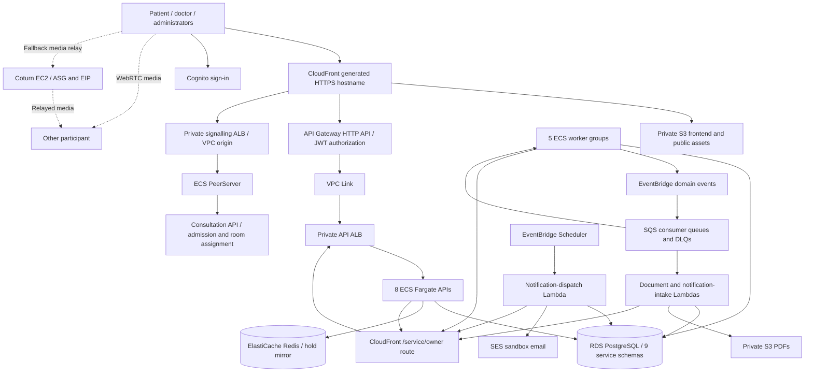

# AWS demo architecture

This describes the checked-in `infra/envs/demo` composition. It uses the
`managed` deployment profile with `domain_free=true`, Linux AMD64 containers,
managed Redis and NAT Gateway egress. RF32/RF51 record historical AWS deployment
in the [backlog](../implementation-plan.md); this documentation refresh does not
reinspect live AWS resources. For local Docker/Floci, use [Compose](compose-stack.md).

## How traffic moves

The frontend is a compiled Vite bundle in S3, served through CloudFront; AWS does
not run the development Vite server. Cognito issues tokens; API Gateway checks
JWTs on protected browser routes, and APIs enforce current roles, clinic scope
and resource ownership. Public clinic GETs can be cached for up to 60 seconds;
protected API responses, writes and signalling are not cached.

Domain-free mode gives the two internal ALBs private CloudFront VPC origins.
CloudFront and VPC Link reach their ALBs over HTTP inside restricted VPC paths.
Browser traffic uses HTTPS/WSS; this is not end-to-end application TLS.
Service-to-service calls use the generated CloudFront hostname's `/service/<owner>`
route. A viewer function admits the Terraform-owned NAT egress IPs and rewrites
the owner path. APIs still require their purpose-specific service credentials;
the IP allowlist alone grants no business permission.

PeerServer handles signalling, not clinical records or media storage. Consultation
authorizes admission and persists room-to-node assignments. Browsers exchange
WebRTC media directly where possible, falling back to coturn's TCP/UDP 3478 and
bounded UDP relay range. TURN-over-TLS is not configured.

## Data and asynchronous work

One private RDS database holds nine service-owned schemas. A clinic is isolated
by tenant IDs and authorization, not a separate schema. APIs and workers use the
owning service's DB role. See [tables and migrations](database/README.md).

Booking capacity is enforced in PostgreSQL using locks, persisted deadlines and
an active-reservation unique index. Redis mirrors an appointment ID with an
absolute expiry; losing that key never releases a DB reservation. The expiry
worker and lazy expiry recover overdue holds. See the [hold walkthrough](../services/scheduling/docs/holds.md).

Business transactions stage outbox rows alongside domain changes. Publishers send
events to EventBridge; routes deliver them to SQS queues with DLQs. Consumers
commit inbox/deduplicated domain effects before acknowledging. Five ECS worker
groups serve scheduling, billing, clinical records, document publishing and
fulfilment. Document generation and notification intake run in Lambda; a separate
once-per-minute Lambda schedule dispatches durable email jobs. Ambiguous sends
remain held for review to avoid duplicate mail. See [email behavior](patient-emails.md)
and [replay procedure](messaging-replay.md).

## Demo capacity and limitations

| Component | Enabled demo configuration | Consequence |
| --- | --- | --- |
| Fargate | 8 API tasks + 5 worker-group tasks + 1 signalling task | One per workload; min/max one prevents scale-out |
| API concurrency | Uvicorn ceiling 64 per API container | Includes open connections; not a measured throughput guarantee |
| Lambda | Three functions, reserved concurrency one each | FIFO ordering can further serialize work |
| RDS | PostgreSQL 17, `db.t4g.micro`, 20 GiB, no Multi-AZ standby | One DB failure can interrupt all domains |
| Redis | One TLS/encrypted `cache.t4g.micro`, no replica | Readiness can fail during a cache outage; DB still owns capacity |
| Egress / TURN | One NAT Gateway; one TURN ASG instance | Replacement mechanisms exist; one instance is not hot redundancy |
| Data protection | Managed-profile 7-day RDS backups, deletion protection, final snapshot, S3 versioning | Restore and disaster recovery still need testing |
| Providers | Stripe test mode, Lalamove sandbox, SES sandbox restrictions | Demo workflows do not establish live-provider readiness |

Two-AZ subnets do not make singleton workloads highly available. The demo root
does not expose the module's scale/failover variables. Its use of production
application guards does not certify production capacity or compliance.

Use [demo Terraform instructions](../infra/envs/demo/README.md) to reproduce the
release sequence. The older [sg-demo example](../infra/examples/sg-demo/README.md)
is a separate ARM64 cost-saving layout with a shared NAT/TURN host and colocated
workers; its nine-task count and costs do not describe this deployment.
