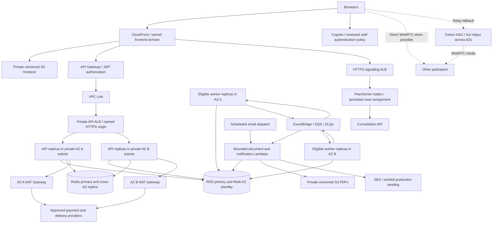

# Intended production architecture

This is the target design for operating TeleLink with production availability and
provider integrations. The [managed Terraform example](../infra/examples/sg-managed/README.md)
implements much of the service layout, but defaults to demo-sized singletons.
There is **no `infra/envs/prod` root** and no production deployment is claimed.
The [current demo architecture](demo-architecture.md) is documented separately.

The diagram shows the intended steady state after configuration and acceptance,
not resources created by default. Private worker/Lambda outbound traffic also
uses the VPC's AZ-local NAT routes. Service calls use the named private API origin;
the browser never receives internal service credentials. The named profile needs
two distinct owned regional origin names and a public Route53 zone for certificate
validation. The frontend may retain the generated CloudFront name; an owned
frontend alias additionally needs its CloudFront certificate in `us-east-1`.

## Mapping the target to Terraform

| Area | Existing mechanism | Production work still required |
| --- | --- | --- |
| APIs | Private Fargate, CPU target tracking, `min_tasks` / `max_tasks`, circuit-breaker rollback | Size from measured request/DB load; keep hot capacity across AZs and test replacement |
| Workers | Separate owning-service groups, worker minima/maxima | Fulfilment tracking stays at one poller per provider account; coordinate before parallelizing |
| Database | `database_multi_az=true` enables standby; managed profile protects deletion and keeps 7-day backups | Connection/storage budget, retention requirements, restore drills and agreed recovery objectives |
| Redis | `redis_node_count>=2` enables replica, Multi-AZ and promotion | Test reconnection/readiness during promotion; no booking truth may depend on Redis |
| Egress | `nat_gateway_count=2` creates AZ-local routes | Review provider allowlists and both egress IPs; test an AZ outage |
| Signalling | Persisted node heartbeat/room assignment, configurable replicas | Verify room affinity, node loss and browser recovery across two networks |
| TURN | ASG, health agent, launch readiness and bounded EIP pool | Hot relay capacity, ICE recovery and TURN TLS remain acceptance/design work |
| Events / Lambda | Durable outbox/inbox, DLQs, bounded concurrency | FIFO group ordering limits parallelism; exercise replay, poison messages and DB connection pressure |
| Storage / release | Private versioned buckets, digest-pinned images, one-off migration tasks | Tested rollback, retention/lifecycle and enough retained ECR images for the rollback window |
| Access / operations | JWT plus owner checks, service secrets, logs/alarms and budget alerts | Reviewed staff MFA, finer process IAM, audit/access logging, alert response and WAF policy |
| External providers | Test/sandbox adapters and recipient checks | Approved live-provider configuration, SES production access and end-to-end acceptance |

The supplied [scale-two overlay](../infra/examples/sg-managed/scale-two.tfvars.example)
is a review/test starting point: API/signalling and eligible worker minima/maxima
two, Lambda reservations two, RDS standby, two Redis nodes, two NAT Gateways and
two TURN instances. It requires `allow_scale_out=true`. It does not increase
database instance/storage sizes, eliminate the fulfilment singleton, or parallelize
one FIFO message group. It is not a production sizing recommendation.

## Release and acceptance boundary

Choose a separately owned production root/state/account boundary before rollout;
the reference example is not an in-place conversion of the deployed demo. Do not
point two Terraform states at the same resources. This task adds documentation,
not a prod root or changed capacity.

Use the [release tooling](RF31-production-release.md) to build/publish compatible
AMD64 images and the frontend with actual public settings. Provision foundation,
populate Secrets Manager, bootstrap roles, run all nine owner migrations, then
enable traffic and consumers. Migrations must run once per owner before rollout,
not on replica startup. See [database operations](database/README.md).

Before calling this production-ready, verify authenticated patient/doctor/admin
journeys, payment and delivery outcomes, private downloads and email deduplication;
exercise AZ/task/cache/relay failure, backup restore and rollback; and record
capacity, security, provider and operational acceptance. Historical demo health or
mocked Terraform tests do not satisfy those gates. TLS ends at load balancers;
ALB-to-task traffic remains HTTP, and current TURN is not TLS-enabled.
